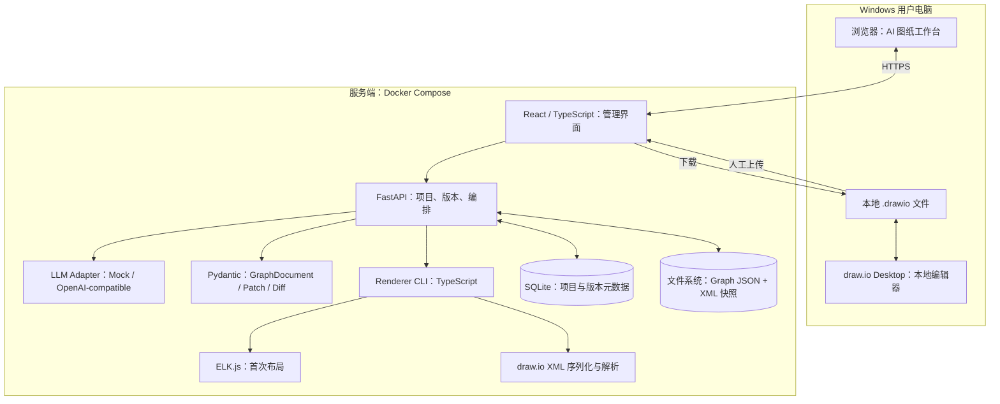

# 01｜技术架构与组件设计

## 1. 整体架构

**读图提示**：业务链并非每次都要调用 LLM。结构化输入直接进入 Graph 验证；对用户已调整过的图做局部修改时，优先修改原始 XML 中受影响的 cell。

## 2. 技术选型

| 部件 | 首版技术 | 执行位置 | 职责 |
|---|---|---|---|
| 管理 UI | React + TypeScript + Vite | 浏览器/静态文件服务 | 输入、预览差异、下载、上传、历史版本 |
| 业务 API | Python + FastAPI + Pydantic v2 | 服务端 | 请求、校验、图纸版本、编排 |
| 模型接入 | OpenAI-compatible API / mock | 服务端/远程推理节点 | 从文本得到结构化 Graph/Patch |
| 排版 | ELK.js layered | Node.js 服务端进程 | 层级布局、嵌套分组、连接线路径 |
| 图文件适配 | TypeScript XML serializer/parser | 服务端 | `.drawio` 生成及回导 |
| 数据库 | SQLite | 服务端 | 图纸、版本、任务元信息 |
| 文件存储 | 本地目录 | 服务端 | Graph JSON、原始 XML、Patch、manifest |
| 编排/部署 | Docker Compose | 服务端 | 简单部署与配置 |
| 图形精修 | draw.io Desktop | Windows | 真实本地图形编辑 |

> LLM 参数规模不是运行本项目的前提；首轮使用 mock，后续可用 9B 文本模型做基线，是否换更大模型取决于结构化关系识别的基准测试。GPU 只服务于本地 LLM 推理，不服务于绘图。

## 3. 五个服务端核心模块

1. **Graph Core**：GraphDocument/Patch 类型、唯一 ID、引用完整性、嵌套组循环检测、业务规则；不依赖图形编辑器。
2. **AI Adapter**：`parse_graph(text, diagram_type)` 和 `propose_patch(instruction, current_graph)`；mock + OpenAI-compatible，带 schema 验证与有限次数修复。
3. **Layout Renderer**：ELK layered 生成初次布局；按图类型套网络/业务模板；对已人工排好位置的图采用锚点与空位插入策略。
4. **Drawio Adapter**：Graph ↔ XML 结构；对原始 XML AST 做定向变更；处理压缩/未压缩页面与 unknown cells。
5. **Project/Version Store**：持久化版本文件、哈希和审计元数据；基于 `baseVersion` 防冲突；不覆盖原文件。

## 4. 两种输入路径

### 确定性路径（Phase 0 必须）

`Graph JSON → Pydantic/Semantic Validation → ELK.js → draw.io XML → 文件下载`

应可在无网络、无 LLM、无 GPU 的开发机器上测试。两份 fixtures 是验收输入，不能给示例 ID 做硬编码特殊处理。

### 自然语言路径（Phase 1）

`用户文字 → AI Adapter → GraphDraft + warnings → Schema + semantic check → 预览 → Layout → XML`。

语义不明确的节点和线不能被模型自动补齐。需要用户确认时，不应直接生成未经确认的物理连接。

## 5. 用户回导后的续编路径（Phase 2）

1. 用户下载 `.drawio`，用 Windows draw.io Desktop 打开编辑并保存。
2. 用户在浏览器上传最新文件，输入当前对应的图纸版本号。
3. 服务端安全解析 XML、计算 Diff（新增/删除/位置/改名/端点/样式），预览并提交新版本。
4. 用户输入增量修改指令，模型输出 GraphPatch，后端验证后展示影响与需要确认的操作。
5. 确认后仅修改相关 Graph 对象与 XML cells，受保护的手工坐标不改变。
6. 新文件下载后再次在 draw.io Desktop 打开。

## 6. Web 管理台最小页面

- **项目与图纸列表**：新建/打开、版本状态。
- **生成页**：输入文字/JSON、选择网络/业务、查看 Graph / warnings、生成下载。
- **回导与继续修改页**：上传 `.drawio`、比较差异、确认导入、输入修改指令、预览 Patch、下载新版本。
- **历史版本页**：版本号、时间、来源、下载；回滚应新建版本而非抹除历史。

不需要在浏览器中实现设备拖放、连线、图形库。不能声称浏览器能直接感知用户 Windows 文件是否被保存。

## 7. 部署形态

首版一台服务器即可。建议一个 Git 仓库，`backend/`、`renderer/`、`frontend/`、`deploy/` 四部分：

- Node.js Renderer 首选通过 CLI 由 API 调用，stdin/stdout 传递受校验数据；`subprocess.run` 指定 argv、`shell=False`、timeout、输出大小限制；必要时再拆独立服务。
- Python FastAPI 负责所有外部 API；使用 SQLite+文件系统即可，不需要一开始使用 Redis、消息队列或微服务。
- 模型启用状态、服务地址、密钥、模型和调用参数通过门户更新。FastAPI 将配置保存在 SQLite，每次模型调用读取当前配置。运行路径与部署限额通过环境变量管理。
- 生产内网拓扑优先接私有模型；默认不日志记录原始文本、账号密钥和完整网络资产。
